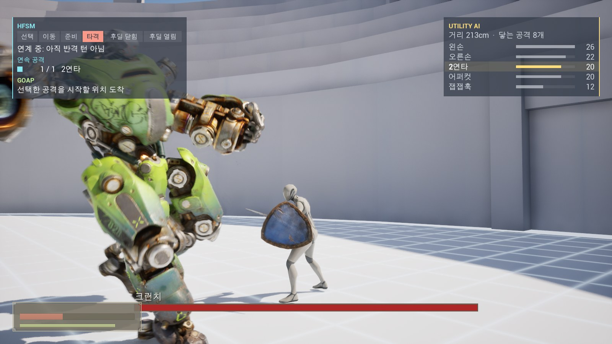
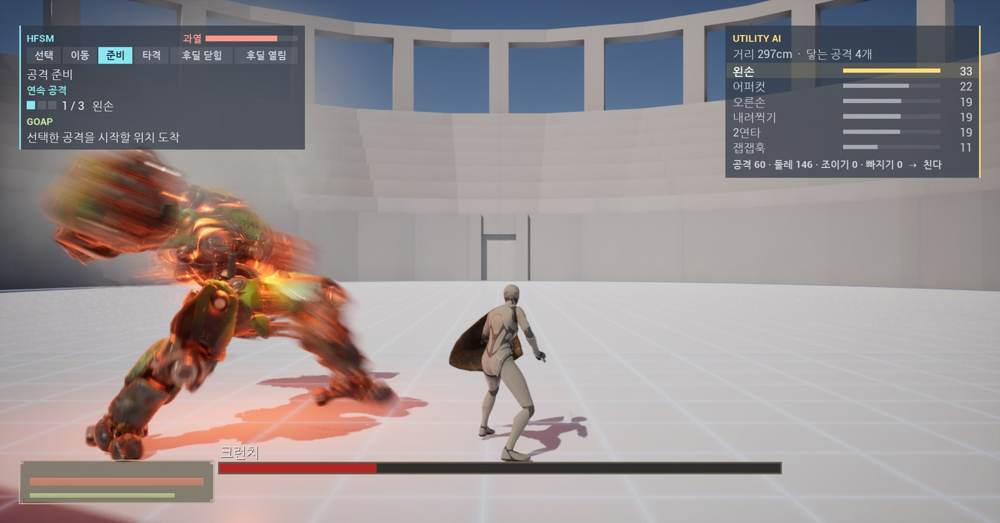
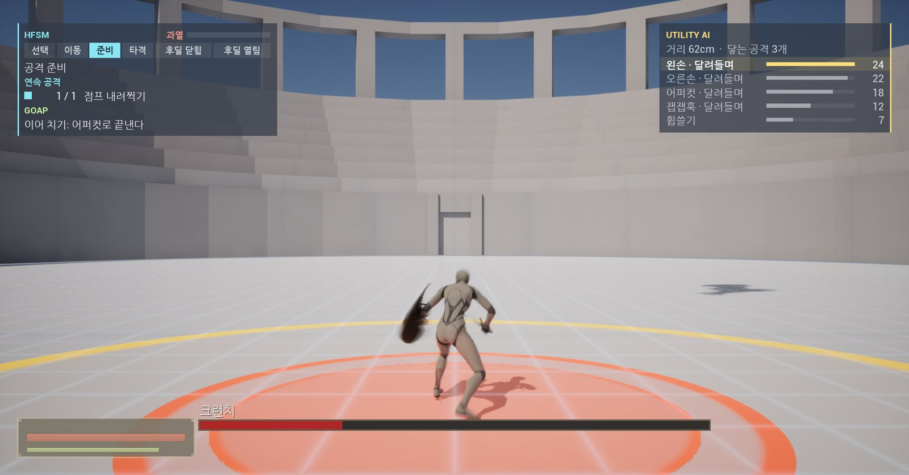
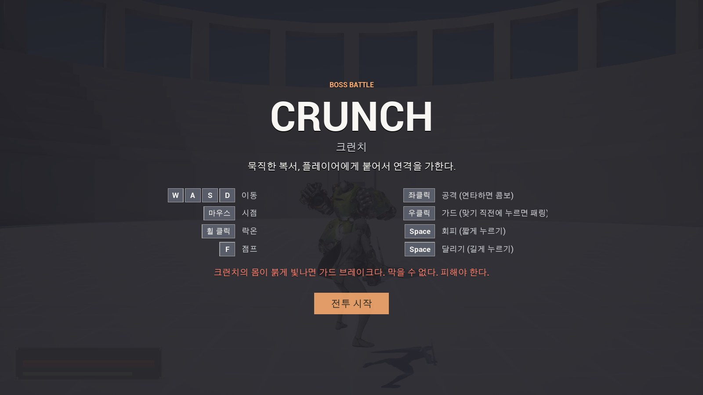

# 보스 AI 프로토타입: Crunch

Unreal Engine 5.8로 만든 소울라이크 1:1 보스전입니다.
Crunch는 묵직한 복서고, 물밀듯이 들어오는 연격이 특징입니다.

**[플레이 빌드 받기](https://github.com/ChoKyungHwan98/Boss_AI_Prototype/releases/latest)** · [영상](https://www.youtube.com/watch?v=XwLNKzSFJSQ) · [기획서 (PDF)](https://chokyunghwan98.github.io/Portfolio/docs/battle/crunch-boss-design.pdf) · [포트폴리오](https://chokyunghwan98.github.io/Portfolio/)

## 플레이하기

1. [Releases](https://github.com/ChoKyungHwan98/Boss_AI_Prototype/releases/latest)에서 `Boss_AI_Prototype_Win64.zip`을 받습니다.
2. 압축을 풀고 `Battle.exe`를 실행합니다.
3. 시작 화면에서 **전투 시작**을 누릅니다. 끝낼 때는 `Alt + F4`를 누릅니다.

- Windows 10/11 64비트, DirectX 12를 지원하는 그래픽카드가 필요합니다.
- "Windows의 PC 보호" 창이 뜨면 **추가 정보 → 실행**을 누릅니다. 서명하지 않은 개인 빌드라서 뜨는 창입니다.
- 실행되지 않으면 압축을 푼 폴더의 `Engine\Extras\Redist\en-us\vc_redist.x64.exe`를 먼저 설치합니다.
- 받는 파일은 약 715MB, 압축을 풀면 약 850MB입니다.

## 조작

| 키 | 동작 |
|---|---|
| `W` `A` `S` `D` | 이동 |
| 마우스 | 시점 |
| 휠 클릭 | 락온 |
| `F` | 점프 |
| 좌클릭 | 공격 (연타하면 콤보) |
| 우클릭 | 가드 (누르고 있는 동안). 맞기 직전에 누르면 패링 |
| `Space` 짧게 | 회피 |
| `Space` 길게 | 달리기 |

## 만들면서 세운 기준

1. **공격은 읽을 수 있어야 합니다.** 공격하기 전에 크게 동작을 취합니다. 그걸 보고 피합니다.
2. **끊임없이 몰아치되 보상이 있어야 합니다.** 공격하고 나면 틈이 생깁니다. 그때가 딜 타이밍입니다.
3. **원거리 공격이 없습니다.** 대신 물러나면 따라붙어 계속 칩니다.
4. **플레이어가 반복하는 행동에는 대응 패턴이 있습니다.** 거리를 벌리고 구르면 한 박자 늦은 어퍼컷이 달려듭니다. 계속 패링하면 가드 브레이크로 보복합니다. 막지 말고 피해야 합니다.

체력 30%부터는 과열되어 더 빠르게 몰아칩니다. 대신 김이 심해지면 지쳐서 멈춥니다.

| 2페이즈 과열 | 점프 내려찍기 예고 |
|---|---|
|  |  |

## 화면의 AI 표시

보스가 무엇을 판단하고 있는지 전투 중에 화면에 띄웠습니다.

- **왼쪽 위, HFSM: 지금 무엇을 하고 있나.** 선택 → 이동 → 준비 → 타격 → 후딜 닫힘 → 후딜 열림 중 지금 단계와, 이번에 몇 번 이어 치는지를 보여 줍니다.
- **왼쪽 아래, GOAP: 어떻게 할 것인가.** 고른 공격을 시작할 위치로 가거나 이어 칠 공격을 정하는 계획입니다.
- **오른쪽, Utility AI: 무엇을 고를 것인가.** 지금 거리와 닿는 공격, 공격마다 매긴 점수입니다. 가장 높은 점수가 강조됩니다.

## 제작

- 기획 · 밸런스 · QA: 조경환
- 구현: AI 도구 활용
- 보스 캐릭터는 Epic Games의 Paragon 에셋(Crunch)이고, 그 밖의 애니메이션과 환경도 외부 에셋을 썼습니다. 에셋 원본은 이 저장소에 포함하지 않습니다.
